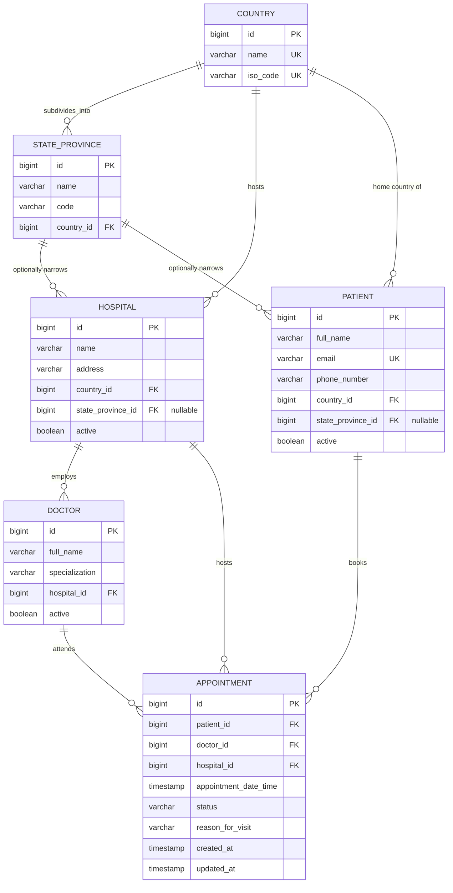
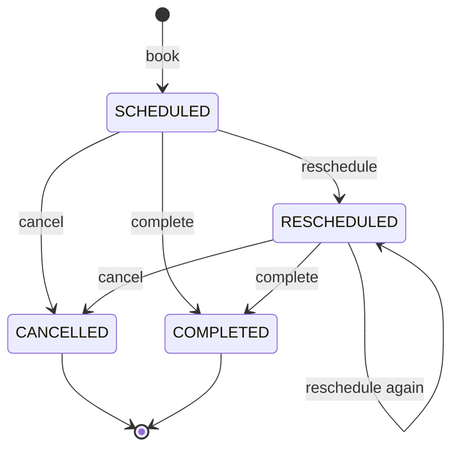

# Canonical Data Model — Hospital Appointment API

This document defines the single source of truth for how data is structured
across the Hospital Appointment API: entities, attributes, relationships,
constraints, and the rules that govern valid state. It should stay in sync
with `src/main/java/com/hospital/appointment/model/` — if the two ever
diverge, this document (or the code) needs updating.

## 1. Scope

The model covers six entities, split into a location hierarchy and the
scheduling domain that sits on top of it:

**Location hierarchy**
- **Country** — top level; every hospital and patient belongs to one
- **StateProvince** — a state, province, or equivalent first-level division
  within a country; **optional**, since not every country subdivides this way

**Scheduling domain**
- **Hospital** — located in a country and, optionally, a state/province
- **Doctor** — practices at exactly one hospital
- **Patient** — has a home country and, optionally, a state/province
- **Appointment** — links one patient, one doctor, and the hospital that
  doctor practices at, at a specific date/time, with a lifecycle status

This supports the core workflow: a patient searches for a doctor by their own
country (and, if useful, state/province) and specialization, then books,
reschedules, or cancels an appointment with one of the results.

## 2. Entity-Relationship Diagram



**Cardinality in plain English:** a country has many states/provinces,
hospitals, and patients. A state/province (when it exists) further narrows
which hospitals and patients fall under it, but a hospital or patient can
also skip straight from country with no state/province at all. A hospital
employs many doctors; a doctor practices at exactly one hospital (no
many-to-many — see 6.1 if that becomes a real need). An appointment ties
together exactly one patient, one doctor, and the hospital that doctor
practices at.

## 3. Entities

### 3.1 Country

| Attribute | Type      | Constraints                         | Notes                                    |
|-----------|-----------|----------------------------------------|-------------------------------------------|
| `id`      | `BIGINT`  | PK, auto-generated                  | Surrogate key                              |
| `name`    | `VARCHAR` | NOT NULL, UNIQUE                    | e.g. "United States", "Nigeria"           |
| `isoCode` | `VARCHAR` | NOT NULL, UNIQUE, 2–3 uppercase letters | ISO 3166-1 alpha-2/alpha-3, e.g. "US", "NGA" |

No soft-delete flag — countries are treated as stable reference data, and
there's no delete endpoint at all (see 6.3).

### 3.2 StateProvince

| Attribute   | Type      | Constraints                                    | Notes |
|-------------|-----------|----------------------------------------------------|-------|
| `id`        | `BIGINT`  | PK, auto-generated                             | Surrogate key |
| `name`      | `VARCHAR` | NOT NULL, UNIQUE per country                    | e.g. "California", "Ontario" |
| `code`      | `VARCHAR` | nullable                                        | e.g. "CA", "ON" — not globally unique, only meaningful paired with its country |
| `country`   | FK → Country | NOT NULL                                     | `country_id` column |

Like `Country`, no soft-delete flag and no delete endpoint.

### 3.3 Hospital

| Attribute        | Type         | Constraints                        | Notes |
|--------------------|--------------|----------------------------------------|-------|
| `id`               | `BIGINT`     | PK, auto-generated                 | Surrogate key |
| `name`             | `VARCHAR`    | NOT NULL                           |       |
| `address`          | `VARCHAR`    | nullable                           |       |
| `country`          | FK → Country | NOT NULL                           | `country_id` column |
| `stateOrProvince`  | FK → StateProvince | nullable                     | `state_province_id` column — optional by design (3.2) |
| `active`           | `BOOLEAN`    | NOT NULL, default `true`           | Soft-delete flag — see 5.2 |

**Relationships:** one `Hospital` → many `Doctor`; one `Hospital` → many
`Appointment`.

### 3.4 Doctor

| Attribute        | Type          | Constraints                       | Notes |
|--------------------|---------------|---------------------------------------|-------|
| `id`               | `BIGINT`      | PK, auto-generated                | Surrogate key |
| `fullName`         | `VARCHAR`     | NOT NULL                          |       |
| `specialization`   | `VARCHAR`     | NOT NULL                          | Free-text today (e.g. "Cardiology"); candidate for a controlled vocabulary later — see 6.2 |
| `hospital`         | FK → Hospital | NOT NULL                          | `hospital_id` column. One hospital per doctor in this model — see 6.1 |
| `active`           | `BOOLEAN`     | NOT NULL, default `true`          | Soft-delete flag — see 5.2. Also checked when booking: an inactive doctor, or a doctor at an inactive hospital, can't be booked for new appointments |

### 3.5 Patient

| Attribute        | Type         | Constraints                              | Notes |
|--------------------|--------------|------------------------------------------------|-------|
| `id`               | `BIGINT`     | PK, auto-generated                         | Surrogate key |
| `fullName`         | `VARCHAR`    | NOT NULL                                   |       |
| `email`            | `VARCHAR`    | NOT NULL, UNIQUE                           | Validated as a proper email format |
| `phoneNumber`      | `VARCHAR`    | NOT NULL, `@Pattern`-validated              | Digits, spaces, `()`, `-`, optional leading `+`, 7–20 chars |
| `country`          | FK → Country | NOT NULL                                   | `country_id` column — every patient has a home country |
| `stateOrProvince`  | FK → StateProvince | nullable                              | `state_province_id` column — optional, same reasoning as Hospital |
| `active`           | `BOOLEAN`    | NOT NULL, default `true`                   | Soft-delete flag — see 5.2 |

### 3.6 Appointment

| Attribute               | Type          | Constraints                              | Notes |
|--------------------------|---------------|---------------------------------------------|-------|
| `id`                     | `BIGINT`      | PK, auto-generated                          | Surrogate key |
| `patient`                | FK → Patient  | NOT NULL                                    | `patient_id` column |
| `doctor`                 | FK → Doctor   | NOT NULL                                    | `doctor_id` column |
| `hospital`               | FK → Hospital | NOT NULL                                    | `hospital_id` column. **Captured from `doctor.getHospital()` at booking time and never changed afterward** — even if the doctor is later reassigned to a different hospital, this appointment still reflects where the visit happened/will happen |
| `appointmentDateTime`    | `TIMESTAMP`   | NOT NULL, must be in the future on create/reschedule | Validated via `@Future` at the DTO layer, not the DB layer |
| `status`                 | `ENUM` (string)| NOT NULL, default `SCHEDULED`              | See 3.7 for the state machine |
| `reasonForVisit`         | `VARCHAR`     | nullable                                    | Free text |
| `createdAt`              | `TIMESTAMP`   | set once, immutable after insert            | Populated by `@PrePersist` |
| `updatedAt`              | `TIMESTAMP`   | updated on every write                      | Populated by `@PreUpdate` |

**Uniqueness rule enforced in the service layer (not yet at the DB level):**
a doctor cannot hold two non-cancelled appointments at the same
`appointmentDateTime`. See 5.1.

### 3.7 AppointmentStatus (enum)

```
SCHEDULED   → the default state after booking
CANCELLED   → terminal; the appointment no longer holds its time slot
RESCHEDULED → set after a successful reschedule; points at a new appointmentDateTime
COMPLETED   → terminal; set via PATCH /api/appointments/{id}/complete once the visit has taken place
```



Rescheduling or completing a `CANCELLED` appointment is rejected, as is
completing an already-`COMPLETED` one. Rescheduling only changes
`appointmentDateTime` — it does not change doctor or hospital; moving a
booking to a different doctor is a cancel + a new booking, by design (see
6.4 if that should become its own operation).

## 4. Naming conventions

- **Java:** entities and fields use standard `UpperCamelCase` / `lowerCamelCase`.
- **Database columns:** Hibernate's default physical naming strategy converts
  camelCase to `snake_case` (e.g. `stateOrProvince` → `state_province_id`,
  `appointmentDateTime` → `appointment_date_time`). No custom
  `@Column(name=...)` overrides are in use, so the DB schema is fully derived
  from the entity field names.
- **Status values:** stored as the enum's name string (`EnumType.STRING`), not
  an ordinal, so the DB stays readable and safe to reorder in code without
  corrupting stored data.
- **Location hierarchy depth:** intentionally stops at two levels (Country →
  StateProvince). There's no City/District level — see 6.5 if that's needed.

## 5. Constraints and integrity rules

### 5.1 Business rules enforced in the service layer

These are **not** enforced by database constraints today — they live in the
`*ServiceImpl` classes:

- A patient and doctor referenced by an appointment must already exist
  (`ResourceNotFoundException` otherwise).
- A doctor must be `active`, and their hospital must be `active`, to be
  booked for a new appointment.
- A state/province supplied for a `Hospital` or `Patient` must actually
  belong to the country supplied alongside it (`InvalidRequestException`,
  `400`, otherwise). This is the main cross-entity validation the location
  hierarchy introduces.
- `appointmentDateTime` must be in the future (DTO-level `@Future`
  validation — bypassable if something writes directly via the repository).
- A doctor cannot have two non-cancelled appointments at the same timestamp
  (checked via `existsByDoctorIdAndAppointmentDateTimeAndStatusNot`, run
  inside a `SERIALIZABLE`-isolation transaction on both `bookAppointment`
  and `rescheduleAppointment` to close most of the concurrent-request race
  window). A losing transaction under contention fails with a serialization
  error the caller should be prepared to retry — this trades a small amount
  of throughput for correctness, and does not silently corrupt data.
- Cancelling an already-cancelled appointment is rejected.
- Rescheduling a cancelled appointment is rejected.
- Completing a cancelled or already-completed appointment is rejected.

**Implication:** the canonical guarantees of this model depend on every
write going through the service layer. If another process writes to these
tables directly, none of the above is enforced. A true DB-level constraint
(a partial unique index on `(doctor_id, appointment_date_time) WHERE status
<> 'CANCELLED'`) would close this permanently regardless of the caller, but
requires a schema migration tool (Flyway/Liquibase) rather than Hibernate's
`ddl-auto=update`, which can't express partial indexes — see 6.6.

### 5.2 Cascade behavior and soft delete

`Hospital.doctors`/`Hospital.appointments`, `Doctor.appointments`, and
`Patient.appointments` all cascade only `PERSIST` and `MERGE` — never
`REMOVE`/`orphanRemoval`. "Deleting" a `Patient`, `Doctor`, or `Hospital`
sets `active = false` rather than removing the row. This means:

- Appointment history is never destroyed by a "delete."
- `GET /api/patients`, `GET /api/doctors`, and `GET /api/hospitals` return
  only `active = true` rows by default, so deactivated records drop out of
  normal listings and out of the search endpoints (4.1 below).
- Direct lookups by id (`GET /api/patients/{id}`, etc.) still return an
  inactive record — appointments referencing it still need a name to display.
- Deactivating a `Hospital` doesn't touch its doctors' own `active` flags,
  but booking is still blocked because the service layer checks the
  hospital's active status too (5.1). Reactivating the hospital alone is
  enough to make its still-active doctors bookable again.
- There's no "reactivate" endpoint for any of the three — flipping `active`
  back to `true` currently needs a direct DB update.
- `Country` and `StateProvince` have no `active` flag and no delete endpoint
  at all (6.3) — they're treated as durable reference data.

## 6. Known gaps / candidate extensions

1. **One hospital per doctor.** A doctor who splits time across multiple
   hospitals isn't representable — that would need a join table
   (`doctor_hospitals`) instead of a single FK on `Doctor`. Not implemented;
   flagging since real-world specialists often do this.
2. **Doctor specialization as a controlled vocabulary.** Still free-text
   (`VARCHAR`), so "Cardiology" and "cardiology" are different values. A
   `Specialization` lookup table would fix this and support reliable
   filtering by specialty.
3. **No delete for `Country`/`StateProvince`.** Deliberately left out: these
   sit under a potentially large number of hospitals and patients, and a
   delete would either need to cascade (destroying referential integrity for
   everything under it) or be blocked by a reference count. Neither felt
   like the right default without knowing which behavior is wanted — worth
   a decision before adding one.
4. **No way to move/reassign a booking to a different doctor or hospital.**
   Rescheduling only changes the time; swapping doctors today is cancel +
   rebook. Fine for now, but a dedicated "transfer" operation might be worth
   adding if that becomes a common patient request.
5. **No City/District level under StateProvince.** Country → StateProvince
   is as deep as the hierarchy goes. Searching "hospitals near me" within a
   big state/province can't be narrowed further than that today.
6. **No true DB-level constraint on (doctor_id, appointment_date_time)
   excluding cancelled rows**, and likewise no DB-level constraint tying a
   `Hospital`'s `state_province_id` to its `country_id` (the cross-check in
   5.1 is service-layer only). `SERIALIZABLE` isolation closes the practical
   race-condition window for concurrent requests through the service layer,
   but a direct write to either table still bypasses both checks. Closing
   this permanently needs a migration tool (Flyway/Liquibase) writing raw
   DDL, since Hibernate's `ddl-auto=update` can't express a partial index or
   a cross-table check constraint.
7. **No audit/history table.** Status changes and reschedules overwrite the
   row in place (`updatedAt` tracks *when*, but not *what changed* or *who
   changed it*).

## 7. Physical schema summary (PostgreSQL)

Auto-generated by Hibernate (`ddl-auto=update`) from the entities above;
shown here for reference as of this API version.

```sql
CREATE TABLE countries (
    id        BIGSERIAL PRIMARY KEY,
    name      VARCHAR NOT NULL UNIQUE,
    iso_code  VARCHAR(3) NOT NULL UNIQUE
);

CREATE TABLE states_provinces (
    id         BIGSERIAL PRIMARY KEY,
    name       VARCHAR NOT NULL,
    code       VARCHAR,
    country_id BIGINT NOT NULL REFERENCES countries(id),
    CONSTRAINT uk_state_name_per_country UNIQUE (country_id, name)
);

CREATE TABLE hospitals (
    id                 BIGSERIAL PRIMARY KEY,
    name               VARCHAR NOT NULL,
    address            VARCHAR,
    country_id         BIGINT NOT NULL REFERENCES countries(id),
    state_province_id  BIGINT REFERENCES states_provinces(id),
    active             BOOLEAN NOT NULL DEFAULT TRUE
);

CREATE TABLE doctors (
    id              BIGSERIAL PRIMARY KEY,
    full_name       VARCHAR NOT NULL,
    specialization  VARCHAR NOT NULL,
    hospital_id     BIGINT NOT NULL REFERENCES hospitals(id),
    active          BOOLEAN NOT NULL DEFAULT TRUE
);

CREATE TABLE patients (
    id                 BIGSERIAL PRIMARY KEY,
    full_name          VARCHAR NOT NULL,
    email              VARCHAR NOT NULL UNIQUE,
    phone_number       VARCHAR NOT NULL,
    country_id         BIGINT NOT NULL REFERENCES countries(id),
    state_province_id  BIGINT REFERENCES states_provinces(id),
    active             BOOLEAN NOT NULL DEFAULT TRUE
);

CREATE TABLE appointments (
    id                      BIGSERIAL PRIMARY KEY,
    patient_id              BIGINT NOT NULL REFERENCES patients(id),
    doctor_id               BIGINT NOT NULL REFERENCES doctors(id),
    hospital_id             BIGINT NOT NULL REFERENCES hospitals(id),
    appointment_date_time   TIMESTAMP NOT NULL,
    status                  VARCHAR NOT NULL,
    reason_for_visit        VARCHAR,
    created_at              TIMESTAMP NOT NULL,
    updated_at              TIMESTAMP
);
```

**Migration note:** `appointments.hospital_id` is new and `NOT NULL`. On a
brand-new database `ddl-auto=update` creates it with no issue. On a database
that already has appointment rows from before this change, adding a
`NOT NULL` column with no default will fail — those rows have no hospital to
backfill from automatically (the only source, `doctor.hospital_id`, didn't
exist at the time they were written either, since `doctors` itself gained
`hospital_id` in this same change). If you've already run this project
against real data, drop and recreate the schema, or hand-write a migration
that backfills both new columns before adding the `NOT NULL` constraints.
